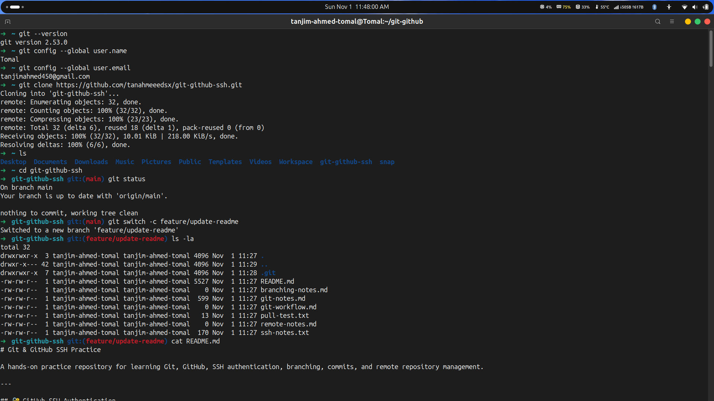
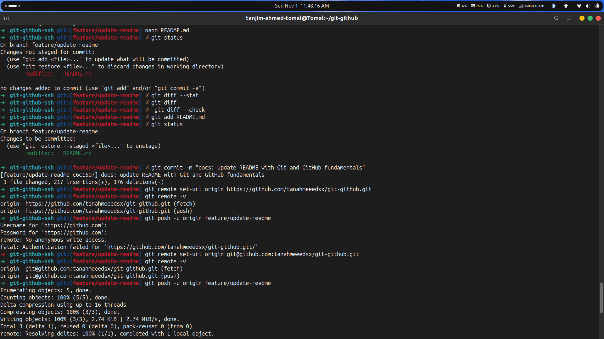
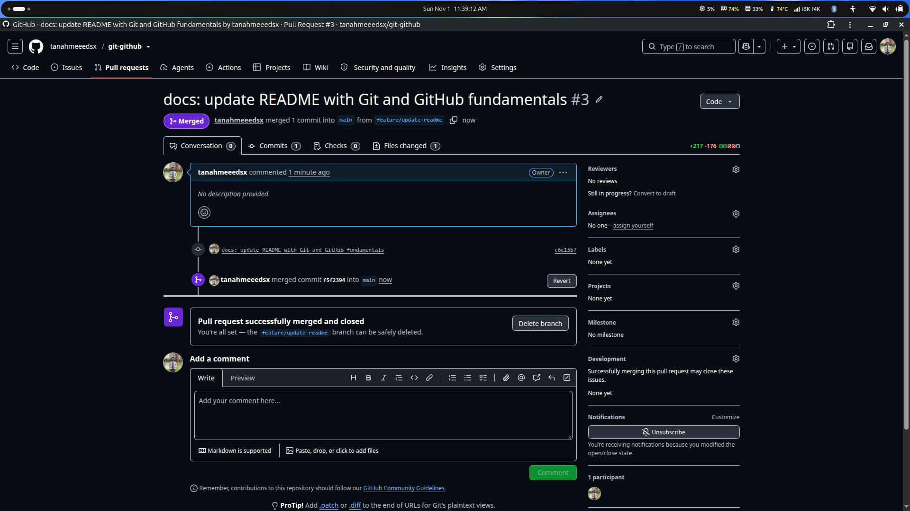

# Git and GitHub

<p align="center">
  
  &nbsp;&nbsp;&nbsp;
  
</p>

<p align="center">
  <b>Learning Git and GitHub through hands-on practice.</b>
  <br />
  Version Control • Branching • Commits • SSH • Pull Requests
</p>

---

## Overview

A hands-on learning repository focused on Git and GitHub fundamentals. It covers essential version control concepts and practical workflows, from repository setup and branching to committing, pushing, and creating Pull Requests.

## Technology Stack

<p align="center">
  
  
  
  
</p>

## Key Concepts

- Git installation and configuration
- Repository cloning and remote management
- Branch creation and feature-based workflows
- Staging, committing, and pushing changes
- SSH authentication with GitHub
- Pull Requests and code review workflows
- Understanding commits versus merges

## Practice Workflow

```text
Clone Repository
      |
      ▼
 Create Feature Branch
      |
      ▼
   Make Changes
      |
      ▼
   Stage & Commit
      |
      ▼
   Push to GitHub
      |
      ▼
   Create Pull Request
      |
      ▼
      Merge
```

## Screenshots

### 01. Git Setup and Repository Cloning

Initial Git version verification, user configuration, repository cloning, and README inspection.

<p align="center">
  
</p>

### 02. Branching, README Update and Push

Creating a feature branch, editing README, reviewing changes, committing, and pushing through SSH.

<p align="center">
  
</p>

### 03. Pull Request and Merge

Successfully created and merged Pull Request #3 into the main branch.

<p align="center">
  
</p>

**Pull Request:** [#3 — Git and GitHub Fundamentals](https://github.com/tanahmeeedsx/git-github/pull/3)

---

<p align="center">
  <b>Learning by doing, one Git command at a time.</b>
</p>
